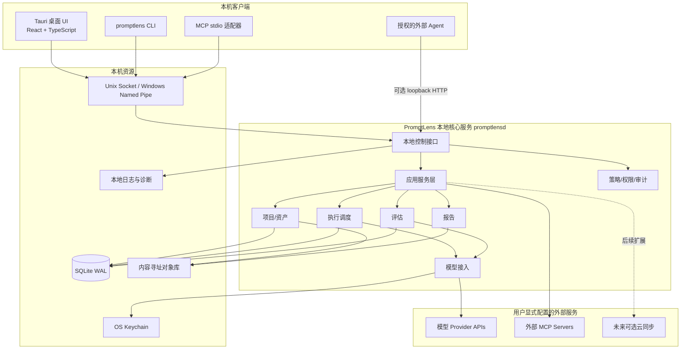
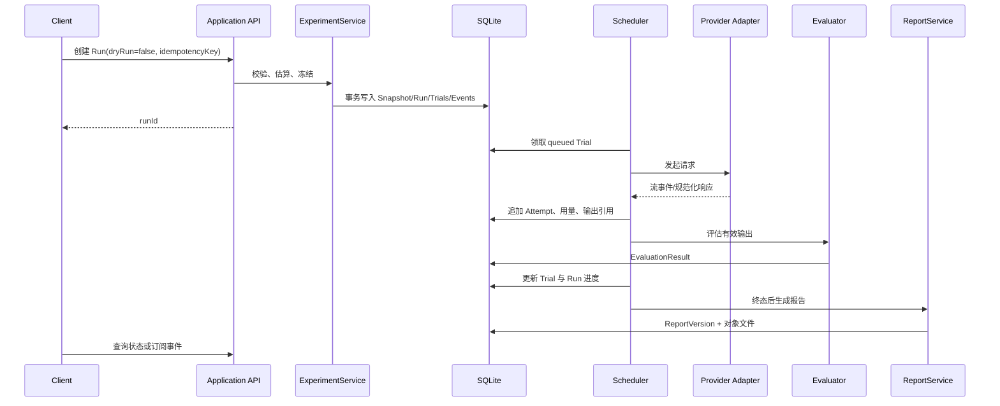

# 05 技术架构设计

## 1. 架构目标与约束

### 1.1 目标

- 三个桌面平台上提供一致的本地体验。
- 核心能力只实现一次，桌面 UI、CLI、MCP 和未来云入口共用。
- 支持长时间批量任务、崩溃恢复、取消和限流。
- 项目可迁移、可备份、可审计；默认不外发用户数据。
- Provider、评估器、导入器和运行模板可增量扩展。

### 1.2 约束

- 不依赖用户安装数据库、Python、Node.js 或 Git 才能使用核心功能。
- 默认安装不包含本地大模型权重。
- 无后台管理员权限；服务以当前用户身份运行。
- 云同步不是本地功能的前置依赖。
- 所有跨平台文件操作必须处理大小写、路径长度、文件锁和同步盘差异。

## 2. 总体架构

采用本地优先的**模块化单体 + 进程边界清晰的适配器**架构。V1 不拆微服务；所有领域逻辑运行在一个本地核心服务中。拆分为多个进程只用于 UI、安全隔离和协议适配，不产生网络分布式一致性。



## 3. 进程与部署模型

### 3.1 本地核心服务 `promptlensd`

- 以当前登录用户身份运行，无系统级 service/daemon 权限。
- 每个用户一个实例，通过进程锁与本地 Socket 保证单写者。
- 桌面应用启动时发现并连接服务；不存在时自动拉起。
- CLI/MCP 在服务不存在时可自动拉起，并通过运行 ID 查询状态。
- 无 GUI、无运行中任务且空闲超过配置时间后可自行退出；默认 10 分钟。
- 启动与退出必须可重入；多个客户端并发启动只产生一个实例。

### 3.2 桌面壳

- 使用 Tauri 2.x 稳定版承载 Web UI。
- React + TypeScript 实现界面；不直接访问 SQLite 或文件系统。
- 只通过带版本的核心 API 调用领域能力。
- 只申请必要系统权限；文件选择、打开路径和通知通过白名单命令完成。

### 3.3 CLI

- 单文件可执行程序，提供交互和全非交互模式。
- 默认连接本地核心服务；`--embedded` 可在受控场景启动进程内核心用于诊断，不用于并发长任务。
- 与 UI 使用同一权限、校验、版本和预算规则。

### 3.4 MCP 服务

- **stdio 模式**：Agent 启动一个 per-client MCP 适配器，它连接本地核心服务；不直接写数据库。
- **Streamable HTTP 模式**：仅绑定到回环地址，需用户显式启用、鉴权并限定作用域。
- **MCP 客户端模式**：核心服务作为 host/client 连接用户授权的外部 Server，获取资源或调用工具。
- 长任务以 `runId` 作为显式句柄，不依赖传输连接保存状态。

### 3.5 为什么不做微服务

V1 的数据边界是本机项目，单用户写入并发有限。微服务会引入网络认证、服务发现、跨服务事务和独立升级，超过用户获得的价值。模块化单体保留接口隔离，未来可将执行节点或云同步单独外移。

## 4. 技术栈

| 层 | 选择 | 理由 |
| --- | --- | --- |
| 桌面壳 | Tauri 2.x 稳定版 | 相对轻量、跨平台、原生文件与密钥链集成 |
| UI | React + TypeScript + Vite | 组件生态成熟，适合复杂表格、Diff、流程编辑 |
| 图表 | Apache ECharts（本地打包） | 离线可用，适合趋势与多系列交互 |
| 核心语言 | Rust 稳定版 | 跨平台单二进制、并发安全和资源可控 |
| 异步与 HTTP | Tokio + reqwest | 流式响应、超时、连接池与并发控制 |
| 数据库 | SQLite（WAL）+ SQLx | 嵌入式、事务、FTS、易备份；避免外部依赖 |
| Schema 校验 | JSON Schema 2020-12 | 资产、运行规格和 MCP 工具输入统一校验 |
| 对象存储 | 本地内容寻址文件 | 大响应与报告不膨胀数据库 |
| 日志 | tracing + 滚动文件 | 结构化、可脱敏、本地诊断 |
| 密钥 | macOS Keychain / Windows Credential Manager / Secret Service | 不把密钥写入项目数据库 |
| 国际化 | Fluent 或等价 ICU 消息格式 | 支持中英文与复数/占位符规则 |
| 测试 | cargo test、Vitest、Playwright、契约测试 | 覆盖核心、UI、端到端和 Provider |

版本必须锁定在经测试矩阵验证的版本，不只使用浮动的 `latest`。依赖升级需走供应链与兼容性检查。

## 5. 模块与接口

### 5.1 应用服务

| 服务 | 职责 | 主要输出 |
| --- | --- | --- |
| ProjectService | 项目发现、创建、锁定、迁移、健康检查 | Project 摘要与能力状态 |
| AssetService | 提示词、用例、测试集版本与库复制 | 不可变版本 ID |
| ModelService | 连接、能力探测、密钥引用、价格与健康 | 模型能力快照 |
| ExperimentService | 编辑实验、预检、冻结快照 | Run + Snapshot |
| RunService | 启动、状态、暂停、停止、派生重试 | RunEvent 与 Trial 状态 |
| EvaluationService | 规则与 LLM 评审、聚合、重新评估 | EvaluationResult |
| ReportService | 生成模板化 Markdown、版本和导出 | ReportVersion |
| IntegrationService | CLI/MCP scope、连接和审计 | Token、连接状态 |

服务之间通过领域接口和显式 DTO 交互，禁止跨模块直接修改对方表或对象。

### 5.2 Provider 适配器接口

统一接口至少表达：

```text
capabilities() -> ProviderCapabilities
list_models(connection) -> ModelDescriptor[]
chat(request, cancellation) -> NormalizedResponse
stream_chat(request, cancellation) -> StreamEvent
estimate_tokens(request) -> Optional<TokenEstimate>
classify_error(raw) -> NormalizedError
```

请求对象包含规范化消息、模型、参数、超时和请求追踪 ID；响应对象包含文本、结束原因、用量、实际模型、Provider 元数据和原始响应引用。禁止 UI 或调度器直接解析厂商 JSON。

适配器类型：

1. 内置厂商适配器：封装已知协议差异与错误语义。
2. OpenAI-compatible 适配器：用于 Ollama、LM Studio、vLLM、部分托管服务。
3. 声明式自定义 HTTP 适配器：通过请求模板、响应路径、鉴权类型和错误映射配置，不执行用户任意脚本。

### 5.3 Evaluator 接口

```text
validate_profile(profile) -> ValidationResult
evaluate(trial_output, context, cancellation) -> EvaluationResult
```

- 规则评估器必须可离线运行。
- LLM 评审器通过 ModelGateway 调用，而不是直接持有 Provider SDK。
- 评估器只能读取规范化输出与明确上下文，不能获得其他 Trial 的未授权数据。
- 评估器版本和所有参数写入 EvaluationProfileVersion。

### 5.4 仓储接口

按聚合提供仓储：

- `ProjectRepository`
- `AssetRepository`
- `RunRepository`
- `EvaluationRepository`
- `ReportRepository`

领域服务不得依赖 SQL 字符串或文件路径；高级搜索可通过显式查询服务实现。跨聚合修改通过应用服务事务完成。

## 6. 运行数据流



关键事务边界：

1. 创建 Run：Snapshot、Run、Trial 索引和初始事件在同一事务提交。
2. 领取 Trial：使用条件更新 `queued -> running`，防止多个 Worker 重复领取。
3. 保存 Attempt：先写原始响应对象并校验哈希，再在数据库登记引用；未登记的对象可安全清理。
4. 完成 Run：聚合计数和终态在同事务提交；报告异步生成但可重试。

## 7. 并发、任务与资源控制

- 使用有界任务队列，不使用每个 Trial 一个无限线程。
- 并发上限按 `全局 → Provider → Model Profile → Run` 四层取最小值。
- 每层维护速率限制器和熔断器；429 响应按 Retry-After 优先。
- 分页读取 Trial，避免启动时把百万行全部载入内存。
- 流式响应写入临时对象并定期落盘；完成或取消后转为不可变对象。
- 单次请求和整次运行均有超时；硬超时后关闭网络连接。
- 文件写入采用 `temp -> flush/fsync -> rename`；数据库使用 WAL 与 busy timeout。

## 8. 错误模型

三层错误：

1. **领域错误**：输入无效、预算不足、版本不存在、比较不可用，返回稳定业务错误码。
2. **Provider 错误**：鉴权、限流、超时、服务端、上下文过长、内容拒绝、协议不兼容，经适配器归一化。
3. **系统错误**：磁盘、数据库、进程、IPC，触发恢复或安全退出。

每个错误至少包含：`code`、`message`、`retryable`、`scope`、`details`、`remediation`、`traceId`。错误消息可本地化；机器消费依赖稳定 `code`，不解析自然语言。

## 9. 可观测性与诊断

- 日志字段：`timestamp`、`level`、`traceId`、`runId`、`trialId`、`module`、`event`、`errorCode`。
- 默认不记录完整提示词、模型输出和鉴权头；诊断模式需用户显式开启并显示预览。
- 运行诊断包包括应用版本、数据库 schema、系统平台、脱敏日志和项目健康报告，不包含密钥。
- 不启用默认远程遥测；更新检查与诊断上传必须独立开关。

## 10. 未来云同步边界

云同步只能通过 `SyncAdapter` 与导出格式交互，不能进入核心领域模型。同步单元是版本化对象与事件，而非实时 SQLite 页面。冲突采用版本向量与用户可读差异解决；凭据默认不跨设备同步。

## 11. 架构质量检查

- UI 代码中不存在直接调用 Provider 的逻辑。
- CLI/MCP 的每条写操作都进入同一权限与审计入口。
- 任意历史 Run 可由快照重建请求清单，不依赖当前草稿。
- 任意重建报告可追溯到相同 EvaluationResult 集和模板版本。
- 断网只影响远程 Provider 与在线扩展，本地项目管理、编辑、历史查看和报告读取继续可用。
- Provider、Evaluator、Exporter 新实现不修改 Run 状态机。

