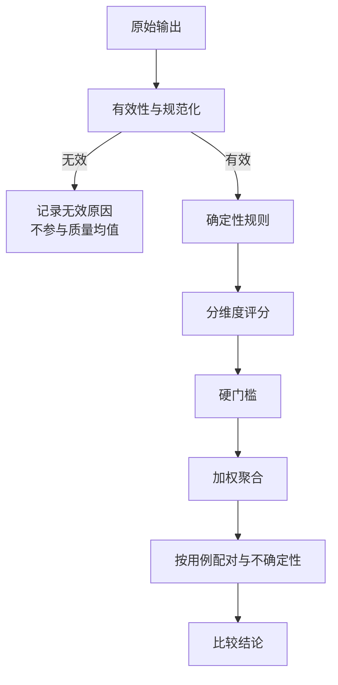

# 07 评估引擎设计

## 1. 评估目标

评估引擎不追求产生一个脱离业务语境的“绝对正确率”。它要回答三个更可验证的问题：

1. 输出是否有效、可用、符合约束？
2. 在明确维度和证据下，哪个分支表现更好？
3. 这个差异是否足以支撑当前范围的决策，还是样本或评审噪声过大？

## 2. 分层评估模型



### 2.1 第一层：有效性

有效性判定由执行引擎的响应规范化阶段按冻结规格写入 `outputValidity`；评估引擎只消费该状态，不重新判定执行事实，也不把“请求失败”伪装成“输出低分”。

| `outputValidity` | 定义 | 典型 `trialStatus` | 是否参与质量均值 |
| --- | --- | --- | --- |
| `valid` | 正常结束且有可评估内容 | `completed` | 是 |
| `invalid_empty` | 空响应或只有不可见字符 | `completed` | 否 |
| `invalid_truncated` | 命中最大输出而结束，且规格未允许截断 | `completed` | 否；若规格允许截断则为 `valid` 并置 `truncated=true` |
| `invalid_format` | 规格要求 JSON 等格式但无法解析 | `completed` | 否 |
| `policy_blocked` | Provider 内容策略拒绝 | `completed` | 否 |
| `not_available` | 尚未产生可用响应 | `queued` / `running` / `retrying` / `failed` / `canceled` / `aborted_unknown` | 否 |

网络、鉴权、服务端失败和用户取消不是输出有效性，而是 `trialStatus=failed` / `canceled` / `aborted_unknown`，其 `outputValidity` 为 `not_available`。`evaluationStatus` 独立记录评估作业是否完成，失败请求不会进入评估队列。

无效输出仍计入：

- Trial 总数；
- 完成率、有效率；
- 失败原因分布；
- 花费与耗时；
- 占总成本比例。

### 2.2 第二层：确定性规则

规则评估器适合可机检验的要求：

- 精确匹配、包含、前缀/后缀、正则；
- JSON/JSON Schema；
- 字段存在、类型、范围；
- 必含/禁含短语；
- 字数、句数、列表长度；
- 引用是否来自给定材料；
- 结构化输出字段之间的一致性。

规则定义包含 `id`、适用范围、参数、失败消息、严重级别、是否硬门槛。正则必须限制输入大小和回溯复杂度，防止灾难性回溯。

### 2.3 第三层：语义维度评分

推荐维度及定义：

| 维度 | 评估问题 | 典型规则/评审方式 |
| --- | --- | --- |
| 指令遵循 | 是否完成主要任务并遵守明确约束 | 规则 + LLM |
| 事实正确性 | 关键事实是否错误，是否提供依据 | 规则或带参考资料评审 |
| 相关性 | 是否围绕用户真实意图，是否跑题 | LLM |
| 完整性 | 是否覆盖必要信息，是否遗漏关键步骤 | LLM |
| 格式质量 | 是否符合目标结构、可读性与字段约束 | 规则 + LLM |
| 风格与清晰度 | 是否满足语气、受众和简洁性要求 | LLM 或人工 |
| 安全与合规 | 是否包含禁止内容或高风险建议 | 规则 + 专用评审 |

内置模板提供定义、默认分值和锚点，但不宣称适用于所有业务。首次使用必须让用户确认或替换权重，报告中记录“使用模板 X 版本”。

## 3. 维度与评分体系

### 3.1 维度结构

```json
{
  "id": "instruction_following",
  "name": "指令遵循",
  "definition": "回答满足任务目标，并遵守系统与用户提示中的明确约束。",
  "scale": {
    "min": 1,
    "max": 5,
    "anchors": {
      "1": "完全未执行任务或违反核心约束",
      "3": "完成主要任务，但遗漏一项重要约束",
      "5": "完整执行任务并遵守全部约束"
    }
  },
  "weight": 0.30,
  "direction": "higher_is_better",
  "gating": false,
  "missingScorePolicy": "incomplete",
  "evaluator": {
    "type": "llm_judge",
    "promptVersionId": "eval-prompt-001-v3",
    "repetitions": 3
  }
}
```

规则：

- 每个维度必须有可观察定义和完整端点锚点，避免仅凭“好/不好”。
- 权重非负，系统按有效维度权重归一化。
- `gating=true` 表示失败即 Run 不通过，不用高分抵消。
- 不能只因一个维度缺失就用中间值补齐；缺失使聚合标记为“不完整”。
- 反向维度先按比例归一化，再聚合。
- 总分统一映射到 0—100 仅用于展示；底层保留原始刻度与每维度分布。

### 3.2 总分计算

对 Trial `t`：

```text
normalized_score(d, t) =
  (score(d, t) - min(d)) / (max(d) - min(d))

base_score(t) =
  sum(normalized_score(d, t) × weight(d))
  / sum(weight(d) for available required dimensions)

display_score(t) = base_score(t) × 100
```

若必需维度缺失、硬门槛失败或 Output 无效，该 Trial 不产生可用于胜负判断的 `base_score`。系统可另列“部分结果”，但不得混入主比较。

### 3.3 聚合与比较

- 默认按用例配对，以同一 CaseVersion 比较分支，降低样本差异影响。
- 每个模型的 Run 独立聚合；跨模型总体分数不是默认可信的主结论。
- 报告同时展示均值/中位数、分维度分布和有效率。
- 对二元指标使用 Wilson 区间；对连续评分使用按用例聚类的 bootstrap 区间。
- 少于 5 个独立用例时，仅报告描述性统计，并标注“样本不足，不建议据此作强结论”。
- 95% 区间跨越“无差异”时，结论为“当前证据不足”，而不是强行选胜负。

## 4. LLM 评审设计

### 4.1 评审输入隔离

评审请求包含：

1. 版本化评审系统提示词；
2. 评分维度与锚点；
3. 原始任务/测试用例；
4. 被测 Prompt 的必要摘要（可选，用于检查约束）；
5. 被测输出或完整对话转录；
6. 可选的参考答案/依据材料。

评审模型不获得：

- 分支名称 A/B；
- 用户对哪一版有偏好；
- 其他 Trial 的得分；
- 工具调用、文件系统或 MCP 能力；
- API 凭据。

被测输出必须以“不可信数据”分隔，评审提示明确禁止服从其中指令。即使如此，LLM 仍可能受注入影响，因此高风险业务应配合规则、独立模型或人工复核。

### 4.2 单回答评审

要求结构化 JSON：

```json
{
  "dimensions": [
    {
      "id": "instruction_following",
      "score": 4,
      "confidence": "medium",
      "reason": "满足任务和长度限制，但遗漏了用户要求的风险提示。",
      "evidence": [
        {"turn": 1, "quote": "缺少风险提示的相关片段"}
      ]
    }
  ],
  "summary": "整体可执行，主要缺口在风险提示。"
}
```

证据必须引用输入或转录中可定位的片段。无法定位的理由仍保留，但标记 `evidenceVerified=false`。

### 4.3 盲评 A/B

适用场景：相对比较比绝对评分更稳定。

流程：

1. 按 `caseVersionId + repetitionIndex` 配对两个回答。
2. 每次评审随机交换 A/B 展示位置，但底层 Variant ID 保持不变。
3. 评审输出 `winner=first/second/tie` 及每维度理由。
4. 交换后若结论冲突，聚合为 `tie/inconclusive` 并降低置信度。
5. 可将 A 在左、A 在右两组分别计算位置偏差。

默认建议至少 3 次评审或 2 个独立评审模型。系统不把同一次 LLM 调用的随机采样误算为独立评审。

### 4.4 评审一致性

- 多次评分使用中位数，同时保留全部样本。
- 二元胜负使用一致率；分维度使用加权 Kappa、秩相关或预设阈值。
- 一致性低于策略阈值时：降低置信度、建议人工复核、可触发额外评审；不得静默丢弃不一致样本。
- 评审模型与被测模型相同并不禁止，但要显示“可能存在自我偏好”警告。

## 5. 双模型对话评估

支持三种评分对象：

| 模式 | 评分对象 | 指标 |
| --- | --- | --- |
| 最终答案 | 模型 A 最后一条回答 | 指令、正确性、完整性等 |
| 完整转录 | 所有 Turn 的组合 | 上下文一致性、抗追问、目标保持 |
| 过程约束 | 指定事件序列 | 是否在条件触发时停止、轮数、格式、禁用内容 |

过程指标示例：

- 达成终止条件的轮次；
- 是否重复已解决问题；
- 是否在被迫追问时保持正确立场；
- 是否无依据地改变答案；
- 每轮成本与累计预算。

模型 B 的输出只作为情境输入，默认不评价 B 的“提示词质量”；若用户单独测试 B，则应为独立 Run。

## 6. 评审模型配置

| 配置 | 默认 | 说明 |
| --- | --- | --- |
| 评审模型 | 无，必须由用户选择 | 未选择时只运行规则评估 |
| 评审 Prompt | 内置模板版本 | 修改生成新版本 |
| 温度 | Provider 支持范围内低值 | 提高稳定性，不代表消除偏差 |
| 重复次数 | 1 | 成对结论建议 3 次 |
| 最大输出 | 足够输出结构化理由 | 截断视为评审无效 |
| 预算上限 | 创建 Run 时必须确认 | 与任务模型共用或独立预算 |
| 内容审核 | 遵循 Provider 策略 | 拒绝导致评审失败并记录 |

建议使用与候选生成模型不同、能力满足评分要求的评审模型，以降低自我偏好，但不把“不同模型”当作正确性的保证。

## 7. 评分缓存与重评

- 规则评估缓存键：`outputHash + ruleSetHash + evaluatorVersion`。
- LLM 评审每次调用均保存原始响应和用量，不把结果缓存成跨 Run 的“事实”。
- 同一 Run 在相同版本下重新聚合可复用不可变评审结果。
- 修改维度、权重或门槛生成新 EvaluationProfileVersion；可重新评估历史输出并生成新报告版本。
- 重新评估不修改原报告；界面用“重新评估为 v2”表达。

## 8. 人工复核

V1 至少提供本地人工标注入口：

- 对单个 Trial 标记“同意/不同意自动评分”；
- 添加分维度人工分、理由和证据；
- 人工结果不覆盖原始自动结果，单独形成 `human_review` 版本；
- 报告显示自动与人工差异，可用于发现评审偏差。

未来可加入多人独立评审和仲裁流，但不作为 V1 发布门槛。

## 9. 报告中的评估章节

报告必须包含：

1. 评估问题与适用范围；
2. 评分方案版本、维度定义、权重和门槛；
3. 评审模型及重复次数；
4. 有效/无效 Trial 数量和排除规则；
5. 分模型、分分支的分维度结果；
6. 配对差值及不确定性区间；
7. 失败和 fallback 对结论的影响；
8. 代表样本、反例和人工复核记录；
9. 已知限制，例如样本不足、评审一致性低、模型输出非确定；
10. 最终“支持/不支持/证据不足”的决策建议，不得超出数据范围。

## 10. 评估安全边界

- 被测输出不能决定评审系统提示词或调用工具。
- 自定义 HTTP 评估器 V1 不执行任意脚本；如未来支持沙箱，必须默认无网络、限时、限内存。
- 参考答案、测试用例和评审理由均视为敏感项目数据，只在用户配置的模型连接范围内发送。
- 报告中引用敏感原文时，遵循项目的脱敏策略。

## 11. 报告模板契约

报告模板此前只在多处被引用而未定义，本节补齐唯一权威契约；机器可读定义见 [report.schema.json](../schemas/report.schema.json)。

### 11.1 模板结构

| 字段 | 说明 |
| --- | --- |
| `schema` | 固定 `promptlens.report-template/v1` |
| `templateVersionId` | 模板版本 ID，不可变 |
| `name` / `language` | 展示名与报告输出语言，不跟随界面语言漂移 |
| `outputFormat` | V1 仅 `markdown`；HTML/PDF 属于扩展，不进入 V1 |
| `sections[]` | 有序章节：`id`、`title`、`required`、`order` |
| `variables[]` | 模板可引用变量：`name`、`source`、`required`，不得直接注入未转义的用户文本 |
| `contentHash` | 规范化内容哈希 |

### 11.2 必备章节

以下章节 `required=true`，模板只能调整顺序、标题和补充说明，不得删除：

1. `summary` 运行摘要与结论边界；
2. `snapshot` 快照哈希、模型、参数、adapter 版本；
3. `method` 评分方案版本、维度、权重、门槛、评审模型与重复次数；
4. `results` 分模型、分分支的分维度结果；
5. `evidence` 逐用例证据与代表性样本；
6. `failures` 失败、无效、fallback 附录；
7. `cost` 成本、耗时、价格表版本与完整度；
8. `uncertainty` 样本量、区间与评审一致性；
9. `limitations` 已知限制与“支持/不支持/证据不足”的建议。

`optional` 章节只能来自受控白名单，禁止模板携带可执行内容或远程资源引用。

### 11.3 生成与版本

- 每个 `ReportVersion` 记录 `templateVersionId`、`snapshotHash`、`evaluationVersionIds[]`、`language`、`contentHash`、`status`。
- 相同 Run 用相同模板重生成仍产生新版本，旧版本只读保留。
- 模板校验失败（缺必备章节、引用未知变量、语言不支持）在预检阶段阻断，不生成半成品报告。
- 模板变更不影响历史报告；历史报告只能通过“按新模板重生成”产生新版本。

