# 10 安全、隐私与权限设计

## 1. 安全目标

PromptLens 处理用户提示词、业务用例、模型输出和可能包含商业秘密的评分依据。安全设计围绕四个目标：

1. 凭据不泄露到项目、日志、报告或 MCP 工具结果。
2. 本地数据避免隐式外发，用户能明确知道一次运行会把哪些数据发送给哪个模型。
3. 模型输出、导入文件和外部 MCP 内容都被视为不可信数据。
4. Agent 与自动化只能执行被授权、可审计且不会造成意外高额费用的操作。

## 2. 数据分类

| 类别 | 示例 | 默认存储 | 默认外发 |
| --- | --- | --- | --- |
| 凭据 | API Key、OAuth Token、Cookie | OS 密钥链 | 仅发给对应 Provider |
| 敏感用户数据 | 私有提示词、真实客户用例、参考答案 | 项目目录 | 仅发给用户选择的任务/评审模型 |
| 普通项目数据 | 用例标签、运行统计、模型参数 | 项目目录 | 不外发 |
| 诊断数据 | 版本、错误码、脱敏日志 | 本机 | 不外发 |
| 云端可选数据 | 同步快照、共享报告 | 默认无 | 用户显式启用并选择范围 |

项目应在导入时允许标记敏感字段。标记影响日志、报告、搜索、导出和模型调用摘要，但不会阻止用户明确选择远程模型。

## 3. 数据流与外发提示

```mermaid
flowchart LR
    P[项目本地数据] --> C[Run 编译器]
    C --> U[用户可见预检]
    U -->|明确启动| M[配置的模型 Provider]
    P --> J[可选评审模型]
    J --> M
    M --> O[本地响应对象]
    O --> R[本地评估与报告]
    P -. 默认关闭 .-> S[云同步]
    L[脱敏日志] -. 默认关闭 .-> T[诊断上传]
```



运行前摘要必须明确：

- 哪些 Provider 和模型会接收数据；
- 将发送提示词、用例、参考答案、模型输出中的哪些类别；
- 是否启用评审模型和外部 MCP 资源；
- 是否启用云端同步或共享。

“总在本地”仅当所有任务与评审模型均为本地端点时成立；UI 不得把“本地项目存储”表述成“任何情况下数据不离开设备”。

## 4. 凭据管理

### 4.1 存储

- macOS：Keychain。
- Windows：Credential Manager / DPAPI 保护的用户凭据。
- Linux：Secret Service（GNOME Keyring / KWallet）；不可用时要求用户选择环境变量引用，不得明文落盘。
- 项目目录只保存 `credentialRef`、Provider 类型和凭据尾号。
- `credentialRef` 采用显式方案前缀：`keychain:<service>/<account>` 或 `env:<VAR_NAME>`；项目与快照只保存引用字符串和由服务端计算的不可逆指纹（末 4 位 + 哈希前缀），永不保存变量值或密钥明文。
- 使用 `env:` 引用时，快照记录 `credentialRefKind=env` 与光栅化指纹；预检阶段解析失败立即阻断，返回 `AUTH_CREDENTIAL_UNAVAILABLE`，不得在运行中静默降级或改用其他凭据。
- 环境变量引用的项目迁移到另一台机器后必须重新授权；迁移向导需明确提示，不得假设变量仍然存在。

### 4.2 使用

- 核心服务按最小范围获取密钥，调用结束后释放引用。
- 密钥不进入日志、错误对象、事件、报告、MCP resource、CLI stdout。
- 调试请求预览对 Authorization、Cookie、签名 Header 和 URL 查询参数进行脱敏。
- 连接导出不包含密钥；导入后要求重新授权。
- 密钥轮换后测试连接；旧引用失效不会自动改用其他凭据。

### 4.3 禁止做法

- 将密钥写入 `promptlens.project.yaml`。
- 将密钥暴露给 LLM 评审 Prompt。
- 将完整请求 Header 写入普通日志。
- 为了方便 CLI 而在环境变量中输出明文密钥。

## 5. 本地接口安全

- 本地 IPC 文件/命名管道权限仅当前用户可访问。
- 可选 HTTP API 只绑定回环地址，使用随机 Bearer token；token 存于用户私有文件。
- 启动时生成短期服务能力证明，客户端连接后仍需按 scope 授权。
- 防止浏览器跨站请求：校验 `Host`、`Origin` 和自定义请求头；不接受任意网站通过 `localhost` 默认调用。
- 不开启 CORS 通配。
- 本地接口仍视为外部输入，执行长度、嵌套深度、分页、超时和并发限制。

## 6. Provider 与网络策略

### 6.1 TLS

- 远程 Provider 默认必须使用 HTTPS，证书链校验不可关闭。
- 允许用户导入企业 CA；不允许全局 `--insecure` 永久开关。
- 远程明文 HTTP 默认阻止。回环地址的 HTTP 可在明确提示后允许，供本地模型服务使用。

### 6.2 SSRF 与私网

自定义 Base URL 需要防止被用作访问本机/内网敏感服务的跳板：

- 解析并规范化主机名；
- 默认允许回环地址仅供用户主动配置的本地模型；
- 阻断云元数据地址、链路本地地址、未知跳转目标；
- 对重定向重新执行地址策略；
- 连接时防 DNS rebinding，不以首次解析结果作为唯一依据；
- 限制 scheme、端口、响应大小与超时。

企业部署可配置显式主机 allowlist，但不得让被测试提示词修改网络目标。

### 6.3 数据最小化

- Provider 只接收完成任务需要的消息。
- 不自动发送项目全局标签、历史运行和未选用用例。
- 可配置在发送前对敏感字段做掩码；掩码会改变实验语义，必须在报告中记录。

## 7. Prompt Injection 与不可信输出

不可信内容来源：

- 测试用例；
- 被测模型输出；
- 用例生成模型输出；
- 外部 MCP resources；
- 导入文件中的说明文本；
- 报告模板中的用户变量。

控制措施：

1. 业务数据放入明确的“引用内容”区，不拼接到系统权限描述中。
2. 评审模型不拥有工具、文件系统、网络或凭据。
3. 被测和生成模型 V1 默认不启用工具调用。
4. 评审输出必须符合 JSON Schema；无法解析则评审失败，不执行其中自由文本。
5. 外部 MCP 资源只能进入待导入区，不能自动变成系统指令或自动化策略。
6. UI 不把模型生成的 HTML/脚本作为可执行内容渲染。
7. Markdown 渲染采用安全模式；禁用任意脚本、内联事件、`javascript:` 链接和远程自动加载资源。
8. 终端输出中转义控制字符，防止恶意 ANSI 序列操纵操作员终端。

Prompt Injection 无法仅靠提示词完全解决，因此高风险项目应使用确定性规则、隔离评审模型、人工复核和最小权限。

## 8. 导入与文件安全

- 限制单文件、总导入大小、行数、字段数、JSON 深度和压缩解压比。
- 归档恢复时防止 Zip Slip 和符号链接逃逸；每个目标路径必须位于项目根目录。
- 不执行导入文件中的公式、宏或脚本。
- CSV 公式注入：导出/打开表格时，对以 `=`, `+`, `-`, `@` 开头的单元格提供安全转义策略。
- 文件名与标签只作为数据，不拼接为未校验的命令参数。
- 路径比较需处理大小写不敏感文件系统和 Unicode 规范化差异。

## 9. MCP 安全

### 9.1 服务端

- 每个连接显式声明 scope 和项目范围。
- 未授权工具不出现在列表，也不接受直接调用。
- 删除项目、永久删除版本、导出含敏感原文、超高预算启动属于敏感工具。
- 工具输入严格 Schema 校验，输出统一脱敏。
- stdio 不信任父进程自动提供宽泛权限；配置由用户创建。
- HTTP 模式按 MCP 授权框架和本地 token 双重校验。

### 9.2 客户端

- Server 首次连接显示其身份、传输、请求权限和数据外发风险。
- 外部 Server 不能绕过 PromptLens 直接写项目。
- 只允许用户选择的资源进入上下文；默认拒绝读取全部项目。
- 工具调用每次按策略批准或预授权，并记录工具名、目标、参数摘要与结果状态。
- 外部提示词和资源不得改变本地 scope。

### 9.3 双向不建立信任传递

PromptLens 作为 MCP Server 收到的凭据不能自动用于其 MCP Client 连接；反之亦然。每侧独立授权、独立审计。

## 10. 权限模型

权限检查最少包含：

```text
actor
project scope
capability + action
resource sensitivity
run budget limit
expiration
```

- UI 本地用户默认可操作其有系统权限的项目。
- Agent token 必须带 scope 与过期时间，可锁定单项目。
- 权限变化后重新校验，不依赖连接建立时的永久缓存。
- 同机但不同 OS 用户不得访问彼此的项目与本地服务。

## 11. 隐私与保留

- 不启用默认遥测、行为分析或远程崩溃自动上传。
- 更新检查只发送必要版本/平台信息，可关闭。
- 日志默认不含提示词正文、模型输出正文、密钥和完整用例。
- 用户可一键查看“本机数据位置”、诊断包内容和将要上传的内容。
- 删除项目使用可恢复区；永久删除包括数据库、对象、导出和索引，但 MCP/外部备份不受本应用控制。
- 原始响应清理后，历史报告必须如实显示证据缺失。
- 备份归档可能包含敏感内容；导出时提供加密选项或在文档中明确用户责任。

## 12. 静态数据保护

V1 默认依赖操作系统账户隔离、文件权限和磁盘加密；项目数据库与对象默认不另行加密。产品必须在设置中清楚说明这一点。

后续可选项目级加密需满足：

- 密钥在系统密钥链；
- 对象和数据库加密策略一致；
- CLI/MCP 通过核心服务透明访问；
- 恢复与迁移时有明确密钥备份/丢失风险提示；
- 不宣称“端到端加密”而服务仍能读取明文。

## 13. 供应链与更新

- 发布包和更新包必须签名，校验后才安装。
- 依赖锁文件进入构建；执行许可证与漏洞扫描。
- Provider 适配器和 MCP 实现遵循最小依赖原则。
- 自动更新可关闭；不允许远程下发任意可执行脚本。
- MCP 或其他插件不允许在 V1 中携带本地原生代码动态加载。

## 14. 安全验收

必须通过：

- 密钥不出现在项目文件、日志、报告和 JSON 输出的自动扫描；
- 本地 HTTP 未授权请求全部拒绝；
- 恶意 Provider URL/重定向不能访问禁止地址；
- 恶意 Markdown/HTML 不执行脚本或自动外联；
- 恶意导入包不能写出项目目录；
- Agent 无 scope 时不能读取提示词、启动 Run 或导出报告；
- 停止任务后不继续产生请求；
- 跨项目 UUID/路径伪造不能绕过项目边界；
- 依赖与安装包签名检查通过。

